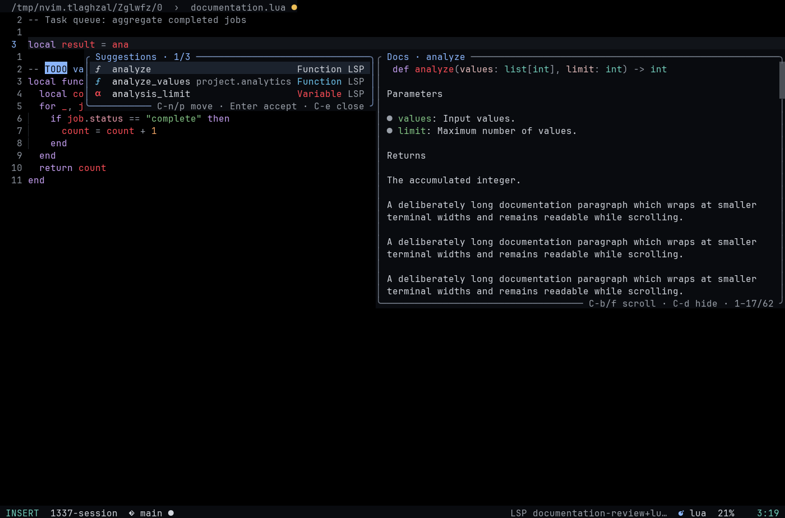

# 1337-session

My 1337 Session Setting: nvim, vscode, zsh and also Zed.

## ElectroVoid Neovim and terminal

ElectroVoid by SireOmega is the default: a true-black canvas, purple focus and
cursor accents, cyan information, green success and red errors. Neovim, its
embedded terminal, Kitty, Alacritty, Starship and tmux share the same palette.
The source palette is [`nvim/themes/electrovoid.json`](nvim/themes/electrovoid.json).
See the [terminal setup](dotfiles/README.md#electrovoid-terminal) to restore it.
The screenshots below show earlier Perfect Black revisions. Python uses `ty` and Ruff.




Completion shows local matches while the language server responds, then favors
semantic suggestions. Ctrl-N/Ctrl-P navigate; Ctrl-K shows documentation,
parameters and usage details; Ctrl-D toggles the completion documentation;
Tab/Shift-Tab follow snippet placeholders. Exact matches rank first, and the
native matcher retains typo tolerance and usage history.

Commands, inputs, documentation, diagnostics, notification history and debugger
inspectors share the updated popup design. See the [popup previews](nvim/POPUPS.md).

The completion image is a capture of this popup revision with demonstration
content. The Python palette and Makefile images are from earlier revisions.
See the [Neovim guide](nvim/README.md) for shortcuts and setup, and the
[design notes](nvim/DESIGN.md) for behavior and testing limits.


Makefile targets run directly from Neovim with `<leader>cm`; `<leader>cM` runs
Make's default target. The Python debugger and its panels load on demand.

## One-command dev environment (Linux x86_64/ARM64, zero sudo)

```sh
git clone https://github.com/laghzal49/1337-session.git && ./1337-session/install.sh
```

`install.sh` builds the complete environment into `~/.local` from official
prebuilt binaries — **never calls sudo**. Downloads and parser builds use a private
temporary directory that is removed when installation exits. It installs:

- JetBrainsMono **Nerd Font Mono** (regular, bold, italic, and bold-italic faces
  for the UI's icons and italic comments; select this family in the terminal)
- **Neovim** latest stable + this repo's config linked to `~/.config/nvim`
  (an existing config is backed up, never deleted)
- **ripgrep · fd · fzf · lazygit**
- **Node.js LTS** (for LSP/mason packages that need npm)
- **uv**, plus a managed Python if the system one can't create venvs
- **ty** and **Ruff** installed through uv's user tool directory
- **debugpy** in an isolated Neovim data directory for Python debugging
- **tree-sitter CLI**, and a `cc` shim via zig if the box has no C compiler
- **clangd** language server for C and C++
- plugins preinstalled headlessly, so the first launch is instant

Idempotent — re-run it any time; installed tools are skipped
(`--force` reinstalls, `--no-sync` skips the headless plugin download).
The installer supports Linux `x86_64` and `aarch64`, keeps downloads and
temporary files under `${TMPDIR:-/tmp}`, and never calls `sudo`.


## Theme selection and cross-platform setup

Choose the palette before starting Neovim:

```sh
nvim                              # ElectroVoid (default)
NVIM_COLOR_STYLE=crimson nvim       # previous black-and-crimson palette
NVIM_COLOR_STYLE=rose nvim          # black-and-rose palette
NVIM_COLOR_STYLE=classic nvim       # original Perfect Black palette
```

Changing this Neovim setting does not switch the external terminal theme.

**Installation routes:**

| Environment | Command | What it does |
| --- | --- | --- |
| Linux x86_64 / ARM64 (including WSL2) | `bash install.sh` | User-local binaries, fonts, tools, plugins and parsers; no sudo |
| Linux / macOS, Neovim already installed | `bash install.sh --config-only` | Only links the config, with backup and XDG support |
| macOS Intel / Apple Silicon with Homebrew | `bash install.sh` | Homebrew tools, uv, config, plugins and parsers; no sudo invoked by our script |
| Windows native (PowerShell) | `.\install.ps1` | Copies a backed-up config to the native Neovim location; install Neovim 0.11+, Git and build/LSP tools separately |

The full Linux download installer still supports only x86_64 and aarch64 and needs
`git`, Python 3 and working HTTPS access. On macOS, install Homebrew before the
full setup; Xcode Command Line Tools may also be needed for C/Tree-sitter builds.
Windows PowerShell setup is **config-only**, not a full replacement for the Linux
toolchain installer. A Windows WSL2 shell follows the Linux route.

The linking helper preserves any previous `nvim` config under a timestamped
`nvim.bak.*` directory/symlink, avoids needless rewrites if already linked and
honors `XDG_CONFIG_HOME`. Windows uses an atomic staged copy rather than an
elevated symlink. On a machine without a Nerd Font use
`NVIM_ASCII_ICONS=1 nvim`.

Run the offline installer regressions with `make portable` (Python 3, Bash and
a POSIX shell; no Neovim or network required). The full `make check` suite needs
Neovim and project dependencies installed.

## Personal dotfiles

Current shell, terminal and desktop configs are in [`dotfiles/`](dotfiles/README.md), with restore instructions.

The [Rust image and PDF reader](nvim/README.md#rust-image-and-pdf-reader) opens media on demand, with zoom, pan and PDF paging.
