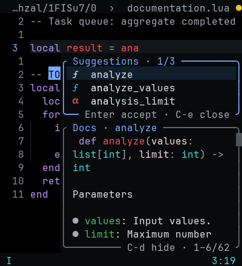
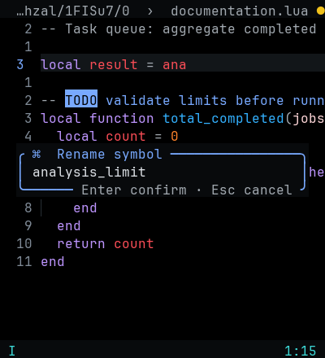

# Popup redesign

The editor remains pure black. Popups use `#080A0C`, regular font weight,
blue input/selection accents and neutral reference borders.

## Completion and reference


`Ctrl-N/P` moves, `Enter` accepts, `Ctrl-E` closes the menu. `Ctrl-B/F` scrolls
documentation and `Ctrl-D` hides/shows it. The frame shows the selected result,
symbol name and visible documentation lines. `K` opens/focuses native reference
text; `q` or Escape closes a focused reference. `Ctrl-K` opens parameter details.

Docs stack vertically on narrow terminals:



## Commands and input


The padded command prompt and suggestions have separate borders. Command results
use a command icon and label. Input prompts keep the operation name above the
editable value, with Enter/Escape controls below.



## Other popups

| Surface | Changes | Preview |
| --- | --- | --- |
| Code actions | Compact choices; Tab preview; Escape cancels | [Actions](assets/popup-actions-140.png) |
| Diagnostics | Severity marker, source, one diagnostic code, readable wrapping | [Diagnostics](assets/popup-diagnostic-140.png) |
| Notifications | Lower-right placement, neutral message body, history shortcut | [Notice](assets/popup-notice-40.png) |
| History | Newest first; `/` search, `n` next match, q/Escape close | [History](assets/popup-history-40.png) |
| Debugger | Central inspectors with edit/expand/close controls | [Watches](assets/popup-debug-watch-140.png) |
| Files/search | Distinct input, results and black preview; concise controls | [Picker](assets/popup-picker-140.png) |

These are attached Neovim captures with demonstration buffers and a test LSP
provider. The watch inspector is shown without a running session.

Reproduce them with installed plugins and the configured font:

```sh
NVIM_CAPTURE_DIR=/tmp/1337-popup-preview \
  uv run --no-project --with pillow --with msgpack python3 nvim/tests/popups_ui.py
```

The script opens only disposable review buffers. It checks for runtime errors;
the interaction regressions live in `ui_review.py`, `documentation_review.py`
and `popups_review.lua`.
