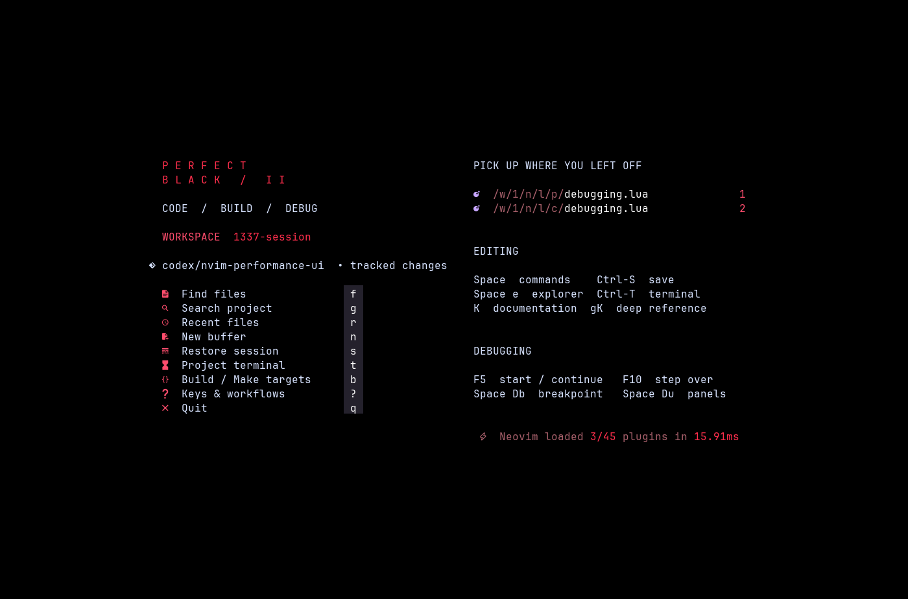
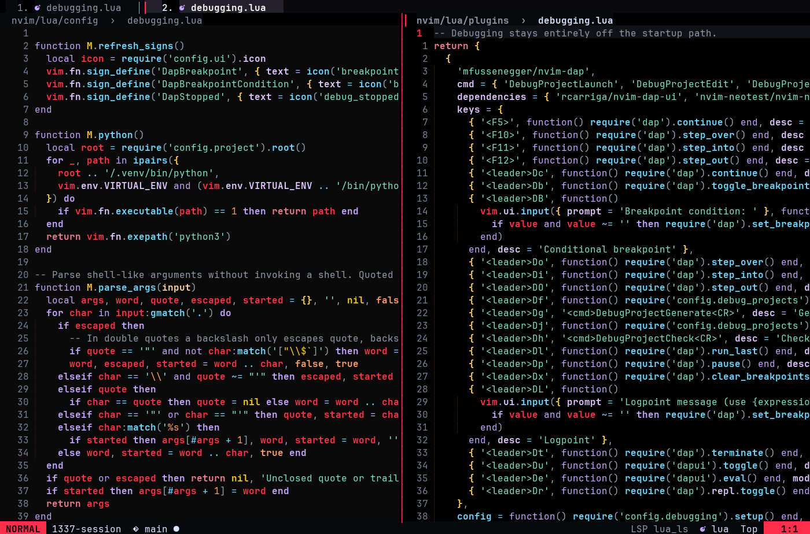
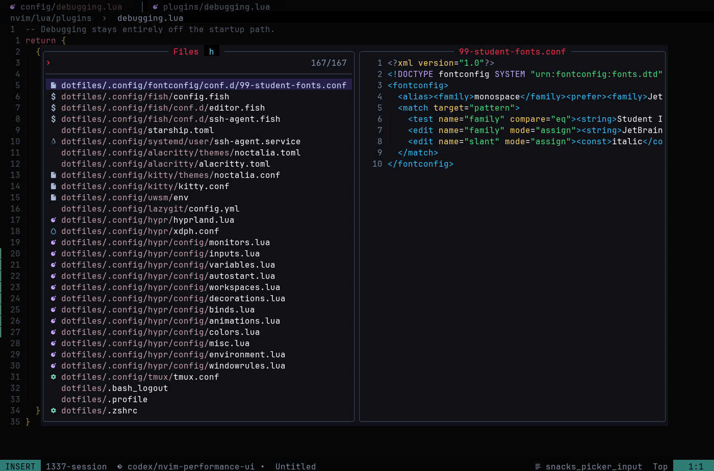
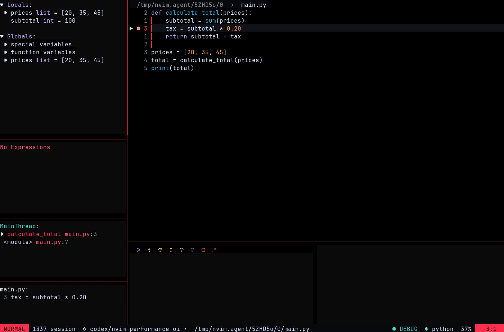
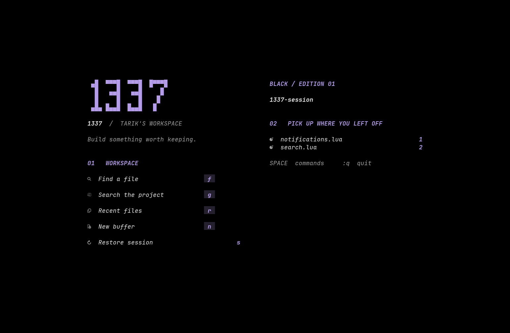
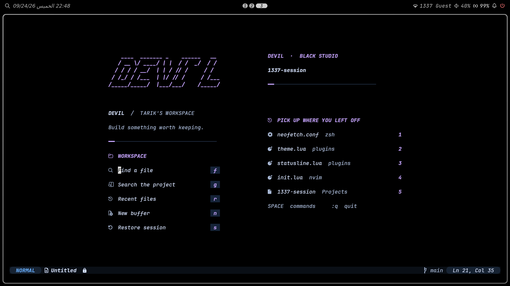
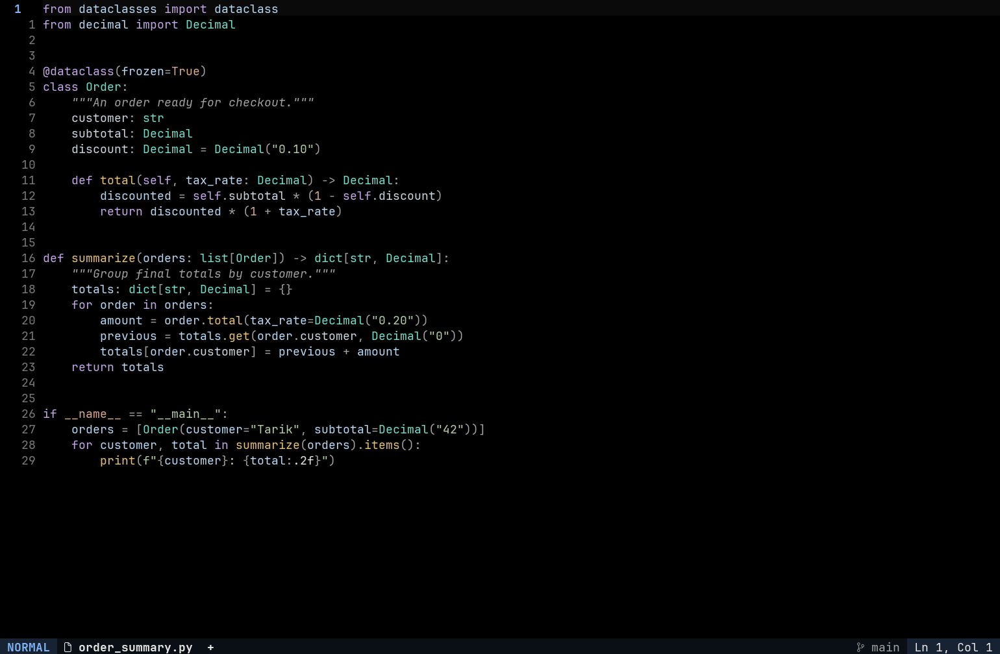
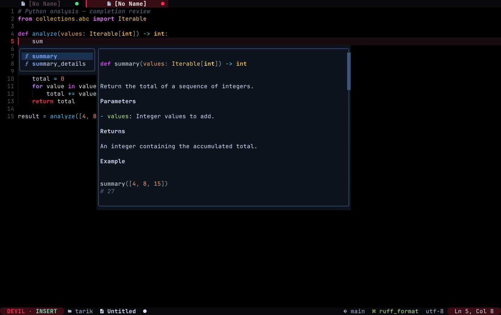
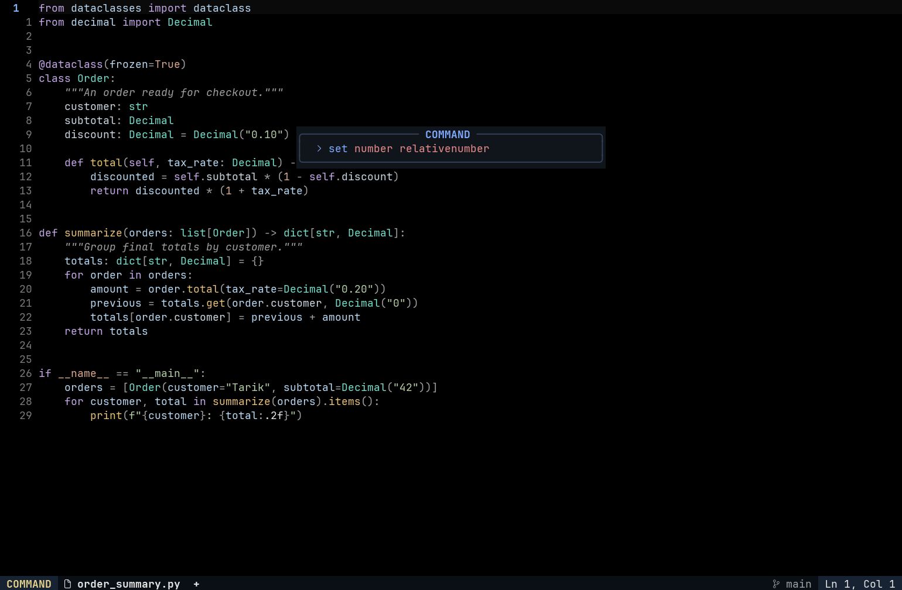
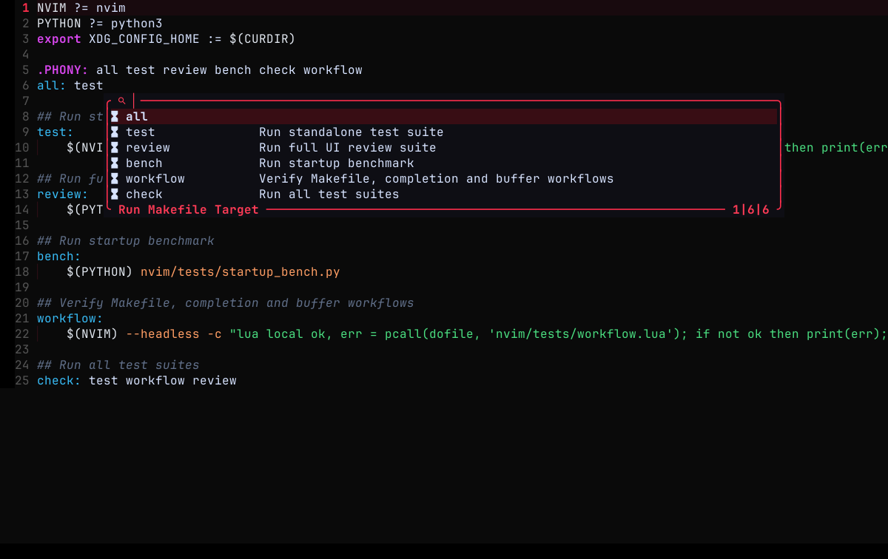

# Perfect Black II — Neovim

A standalone Neovim configuration: **no LazyVim distribution**. lazy.nvim manages
45 explicitly configured plugins and dependencies, pinned in `lazy-lock.json`.
Pure-black code, italic comments, opaque panels, and **ty + Ruff** for Python.
Ruff provides diagnostics through its LSP and formats with
Ruff Format on save; `<leader>cf` runs formatting manually and `<leader>uf`
toggles format-on-save.

## A complete workspace refresh






The new design uses a black editor canvas, charcoal tool surfaces, restrained
crimson focus accents, readable secondary text and semantic colors for code.
The project home replaces the giant logo with a useful launch surface, recent
project files, editing shortcuts and debugger controls. The branch is fetched
asynchronously; `tracked clean` deliberately excludes untracked files.

Native titles show the path and modified state above each editor split. The
statusline gives mode, cached project/branch, filename, diagnostics, search count,
debug/recording state and position in a clear hierarchy. Narrow terminals keep
only the essential state. Buffer tabs use one selection marker and no duplicated
diagnostic badges. Borders and guides are quiet; active split focus is visible.

Everyday files, grep, buffers, diagnostics and symbols now use **Snacks Picker**:
side-by-side live preview on wide screens, stacked preview on smaller ones,
Ctrl-P/Ctrl-N navigation, Escape to close and `?` for actions. Mini Pick remains
for specialized offline documentation, Make targets and code-action previews;
the now-unused Mini Extra plugin and unreachable navigation fallback are removed.
For a minimal search popup, `<leader>fF` opens fast files and `<leader>sG` fast
grep using the existing lightweight picker. The preview-rich picker measured
~25 ms to first files results versus ~13 ms for the compact picker on this machine;
the richer UI trades a little latency for a visible preview.

The old disabled theme spec and duplicate text-object ownership are also removed.

Workspace mode (`<leader>uw`) opens only panels that fit and have useful content,
returns focus to your editor, and preserves windows you repurpose while working.
It no longer automatically opens a terminal. Project tasks run in the background:

| Key | Action |
| --- | --- |
| `<leader>rt` | Discover and run a project build/test/script |
| `<leader>rr` | Rerun the last task |
| `<leader>rs` | Stop the current task |
| `<leader>ro` | Open live or completed task output |

Tasks recognize Make, package.json scripts, Cargo, Go and Python projects. Tool
output stays available; failures with parseable file locations populate quickfix.
Live logs update in batches without taking editor focus. They follow new lines
while you are at the bottom and preserve your position when you scroll upward.
Quickfix parsing covers Cargo, TypeScript/ESLint, Go/compiler and Python outputs,
with the current buffer's compiler settings as a fallback.
Output retention is capped at 1 MiB or 5,000 lines per stream, with a visible
truncation notice. Stopping a task sends SIGTERM, then SIGKILL after one second
if needed. POSIX cancellation stops the task's process group, including ordinary
child processes. Windows stops the direct child; descendants that create their
own session can escape group cleanup.
Tools/packages are installed explicitly, never by opening a project.

The follow-up audit also fixes small-window and Unicode title sizing, keeps Git
change status visible beside long branch names, and makes the dashboard build
action discover tasks across supported projects. Root discovery respects local
working directories and recognizes standalone Node and Python projects. TODO
navigation and selected-line Git history retain their intended keybindings.

The additional project controls are available without adding plugins:

| Control | Feature |
| --- | --- |
| `<leader>ua` / `:UIAccessibility` | Toggle plain core icons, stronger borders and simpler decoration |
| `<leader>uB` / `:BufferPerformanceRestore` | Restore features after shrinking a large buffer, preserving unsaved edits |
| `<leader>Df` / `:DebugProjectLaunch` | Choose a project debugger profile |
| `<leader>Dj` / `:DebugProjectEdit` | Create or edit `.vscode/launch.json` |
| `<leader>Dh` / `:DebugProjectCheck` | Validate project debugger profiles |
| `gsa` / `gsd` / `gsr` | Add, delete or replace surrounding characters |
| `gsf` / `gsF` / `gsh` / `gsn` | Find, highlight or change surround search width |
| `:StationVenvMigrate` | Move a real project environment to local storage while retaining its original backup |

Flash uses `s` immediately; surround shortcuts now start with `gs`. Start with
`NVIM_UI_PRESET=accessible` to make the accessible preset your default. Explicit
`vim.g.black_ui_preset` takes precedence. Live preset changes preserve custom
highlights and the current theme; some third-party hardcoded glyphs may remain.

Performance changes extend beyond startup: cached root lookups, one asynchronous
Git probe per project, no dashboard filesystem walk, no duplicate bufferline
LSP diagnostic pass, bounded large-buffer guards even after edits, and a 500 ms
format-on-save cap. Files over 1 MiB or 20,000 lines switch to a conservative
plain editing mode. After reducing them, use `<leader>uB` to restore the prior
features without wiping the buffer or changing unsaved edits. Recovery refuses
buffers still above the size or Markdown/minified-file budgets. Existing disabled
diagnostic/decorative preferences are retained.

Matched five-run benchmarks on this machine: cached headless startup median
**20.78 → 19.08 ms** (~8% lower); attached idle RSS **21.4 → 20.0 MiB**.
These are local measurements, not promises of LSP or interactive latency.
The final upgrade run supersedes the earlier 15.38 ms audit measurement.
Raw results are in `tests/redesign_results.json`; screenshots are rendered from
Neovim's actual attached UI grid, not mockups.

The bounded typing benchmark (`tests/typing_results.json`) measured median
input/buffer/redraw RPC roundtrips of 4.41 ms for 2,000-line Lua, 4.75 ms for C,
and 51.81 ms for Markdown. Guarded 22,001-line Lua improved from 17.38 ms to
0.54 ms after preventing filetype plugins from restarting its parser. These
measurements exclude LSP and physical display latency; Markdown remains slower.

## Responsiveness and everyday controls

Completion loads on first Insert/Command mode entry (or when an LSP needs its
capabilities); the parser manager loads on the first file. The debugger and its two UI dependencies are loaded only on demand.
Files above 1 MiB, or averaging more than 1,000 bytes per line, use Snacks' plain
big-file view: manual folds, no Tree-sitter highlighting/context, no completion,
and no format-on-save. Explicit `<leader>cf` still formats on request. The existing
stricter Markdown line/size limits continue to apply.

Comments, inactive buffer labels and panel hints have brighter contrast while
keeping the pure-black canvas and crimson accents. The statusline removes secondary details in narrow terminals. Flash labels use dark text on pink for readability.

| Key | Action |
| --- | --- |
| `<leader>ud` | Toggle diagnostics for the current buffer |
| `<leader>uv` | Toggle wrapping in the current window |
| `<leader>ul` / `<leader>ur` | Toggle absolute / relative line numbers |
| `<leader>bo` | Close other buffers, prompting for unsaved changes |
| `j` / `k` | Move by displayed lines; counts use logical lines |

Reopened files restore their last cursor position unless a position was already
selected. Writes keep a temporary backup until they succeed. Station Mode detects
cluster filesystem/hostname/login signals; a repository name alone no longer
activates cluster scans. Use `STATION_1337=1` or `:StationMode on` to opt in elsewhere.
The inode quota parser also handles `df` output without a Lua multiple-return error.

Validation on Neovim 0.11.5: five cached headless launches per config had median
startup **20.78 ms before → 19.08 ms after**. These numbers describe this test
machine, exclude first-install costs, and do not measure LSP readiness or UI latency.
Run `NVIM_BIN=/path/to/nvim python3 nvim/tests/startup_bench.py --runs 5`
and `nvim --headless '+lua dofile("nvim/tests/responsiveness_review.lua")' +qa!`
from the repository root with `XDG_CONFIG_HOME` pointing to the repository.
The responsiveness review expects a non-cluster host with no Station Mode override.

## Debugger and yank feedback

Yanking briefly highlights exactly the copied text for 180 ms, including Visual
selections. There is no popup for each copy.

Debugging uses nvim-dap with scope, watch, stack, breakpoint and console panels
in the existing black/crimson UI. It loads only when a debug key is pressed.
Panels open when a session starts and close when it ends.

| Key | Action |
| --- | --- |
| `F5` / `<leader>Dc` | Start or continue |
| `F10` / `<leader>Do` | Step over |
| `F11` / `<leader>Di` | Step into |
| `F12` / `<leader>DO` | Step out |
| `<leader>Db` / `<leader>DB` | Breakpoint / conditional breakpoint |
| `<leader>Du` / `<leader>De` | Toggle panels / evaluate expression or selection |
| `<leader>Dr` / `<leader>Dt` | Console / terminate |

For Python, install debugpy once in an isolated environment:

```sh
# Linux; default Neovim data directory. Adjust if XDG_DATA_HOME is customized.
uv venv ~/.local/share/nvim/debugpy
uv pip install --python ~/.local/share/nvim/debugpy/bin/python debugpy
```

Alternatively install debugpy in the project environment, or set
`vim.g.debugpy_python` to an interpreter that contains it. The debuggee uses the
project `.venv/bin/python`, then the active `VIRTUAL_ENV`, then `python3` on PATH.
Open a Python file, set a breakpoint, and press F5. Choose a file launch with
arguments, module launch, or local attach when needed. Attach requires an existing
`python -m debugpy --listen 127.0.0.1:5678 --wait-for-client script.py` process.
`<leader>DL` adds a logpoint; `<leader>Dp` pauses; `<leader>Dl` reruns; `<leader>Dx`
clears breakpoints. Live local attach was verified with a disposable debugpy server.

Project profiles use `.vscode/launch.json`; F5 includes them alongside built-ins.
The provider reads the current buffer's project, resolves `${workspaceFolder}`,
and accepts JSON/JSON comments with static arguments. VSCode prompted inputs and
`preLaunchTask`/`postDebugTask` are rejected with guidance; run project tasks
explicitly. Project profiles do not modify the global built-in configurations.

For C/C++, install **GDB 14+ with Python/DAP support**, build with debug symbols
(e.g. `cc -g -O0 main.c -o main`), open the source, and press F5. Supply the compiled
executable at the prompt. Debugger packages are not installed automatically.
Missing adapters show setup guidance. Python breakpoints, variable evaluation,
step-over and clean session/panel exit were tested against real debugpy 1.8.22;
C/C++ launch/attach configuration is provided but an actual GDB session was not tested
in this environment.

Cleanup removed the disabled onedark spec and stale Mini Files status labels.
Function/class text objects are now owned only by nvim-treesitter-textobjects;
Mini AI retains its other useful objects. Most existing pins are retained. Aerial uses its `nvim-0.11` branch
(`c5e56945d9703f7079ccff484b35d0e4c231dd6c`) so the outline works on the
advertised Neovim version. Tree-sitter is pinned for the same reason: its old pin requires Neovim 0.12,
so it is explicitly pinned to the last pre-vim.list main snapshot compatible with
0.11 (`4d9916e477e5d4e3b245845dfd285edf429f3252`). The compatible parser
installer and real Python text-object queries were checked on 0.11.5. The three
debugger dependencies are added and unused Mini Extra is removed from the lockfile.

## Workspace





The current theme uses blood-red accents over black editing surfaces.
The dashboard and older editing screenshots below document earlier revisions.

Navigation now gives a subtle 180 ms destination beacon for definitions,
references, diagnostic jumps, jump history, search selection, buffer switching,
Flash, Aerial and quickfix selection. Ordinary `hjkl` movement stays quiet.
The physical cursor uses a block in Normal/Visual, a bar in Insert/Command,
and an underline in Replace; terminal support determines cursor colors.

Split focus keeps inactive windows dim and uses one native red separator anchor.
Panel highlights are preserved, including Edgy. At 130 columns or wider, the
existing statusline shows the enclosing function/class from an idle-updated
cache. Python, C/C++ and Lua use Tree-sitter; other languages can reuse
already-populated Aerial data. It hides at top level and above 10,000 lines or
1 MiB. No extra status row or sidebar is added. The overview rail is deferred.

Harpoon has been removed; use the existing buffer picker and `Shift-H`/`Shift-L`.
Command suggestions use Blink in Noice's command input: Tab selects a suggestion,
Enter accepts and executes it. Suggestions never replace your input automatically.

## Editing surfaces







The completion image is captured from the current Blink UI using a demo source;
the Python palette and command images are from earlier revisions. The Makefile
screenshot below is also regenerated from the current configuration.

## File browser

Snacks Explorer is the only file browser. Open it with `<leader>e` (toggle)
or `<leader>fe`. Use `<CR>` to open, `a` to create, `r` to rename, `d` to delete,
and `?` for its keymap help. Mini Files and its obsolete decoration code are
removed.

Markdown reader mode is available with `<leader>mr` (or
`:MarkdownReaderEnable`/`:MarkdownReaderDisable`); it enables rendered Markdown,
comfortable wrapping, concealed syntax, and a distraction-free view,
then restores the previous window settings when toggled off. Rendering is bounded
for very large files and keeps links, code languages, checkboxes, tables, quotes,
and YAML front matter readable.

Markdown above 5,000 lines or 512 KiB uses a plain view with manual folds,
without Tree-sitter highlighting/context or rendering. These thresholds are
configurable in `config.markdown`. Reader mode avoids spellchecking and restores
window options when returning to code. Small files keep normal rendering.

The leader popup is **BLACK DECK**, rendered by the existing Which-Key. Immediate
commands come first, followed by Code/Docs and project/system groups. `›` marks a
group. Escape closes; Backspace returns from a nested group. `:BlackDeck` enables
Which-Key's supported repeating mode. Existing keypaths remain available.

Documentation keys:

- `K`: Smart Docs. Qualified offline reference first, then asynchronous LSP/project
  hover, then the existing Python builtin fallback or useful local docs search.
- Insert `Ctrl-K`: compact signature help only; it never opens a reference manual.
- `gK`: Deep Docs. Exact offline reference or MiniPick search, without LSP content.

Press `K` again to focus the reference surface. Normal Vim scrolling and `/` work
there; `q` or Escape closes it. Offline pages support `Ctrl-O` history and Enter on
an exact indexed reference. Blink retains automatic completion docs and `Ctrl-b`,
`Ctrl-f`, `Ctrl-d` scrolling/toggling. All reference surfaces share Perfect Black
colors, bounded dimensions and the existing Markdown renderer.

Python 3.14, C, C++, Lua 5.1, Bash and CMake are the default external references.
They describe those versions, not every dependency or project API. Local manuals
and prebuilt exact/fuzzy indexes live in `stdpath("data")/perfect-black/docs`,
outside Git. Lookup never downloads documentation or scans page files.

```vim
:Docs
:Docs python Path
:Docs update python
:Docs health
:DocsBrowse
:DocsBrowse Path
:DocsBrowse python Path
:DocsUpdate
:DocsUpdate python
:DocsHealth
```

An already-open session can register these commands without restarting:
`:lua require('config.docs_lifecycle').setup()`. `:Devdocs` and `:DevdocsUpdate`
remain aliases for the earlier command names.

The installer attempts the initial download without failing the installation when
offline. Neovim checks the small manifest and index-file presence five seconds
after startup and asynchronously updates missing or stale sets. It performs no
startup network work. Configure before setup:

```lua
vim.g.black_docs_auto_update = true -- false disables automatic downloads
vim.g.black_docs_max_age_days = 7
```

Shell equivalent: `scripts/update-docs all` or `scripts/update-docs python`.
The launcher uses uv; the stdlib-only Python 3.11+ backend can also run directly:
`python3 nvim/scripts/update_docs.py all`. Updates publish immutable generations
through an atomic manifest, with a lock against concurrent updates. Failed updates
preserve existing manuals. `--catalog FILE` supports additional docsets.

Anchored pages show the actual reference section, with a 200-line display cap and
an explicit source link; `gx` opens that link only when requested. Pages above
1 MiB are refused. Ambiguous symbol names go to search, not a guessed namespace.

On idle, supported LSPs underline semantic uses of the cursor symbol within the
viewport. Moving or entering Insert clears them immediately; unsupported servers
show no potentially misleading text matches. This replaces Mini Cursorword.
Multiple LSP locations and code actions use the existing picker; Tab previews
locations or replacement text already supplied by the server. Glance remains
the explicit peek tool.

## Makefile targets



Actual Neovim UI-grid capture of the current configuration. Use `<leader>cm`
or `:Make` to pick a target, `:Make test` to run one directly, and `<leader>cM`
to run the Makefile's default target in a terminal. `:MakePick` also opens the
picker. The picker lists literal targets in the root Makefile; included files,
variable-generated targets, and pattern rules are not expanded. GNU Make runs
the recipe with its normal dependencies and variable expansion.

The debugger is optional and loads on its first keypress. Run `:Lazy clean` to
remove unused local plugin checkouts after updating, then restart Neovim.

## Everyday workflow

- **Snacks Picker:** files, live grep, buffers, commands, diagnostics and
  symbols. Up/Down or Ctrl-P/Ctrl-N moves through results; Alt-P toggles preview,
  Tab selects a result, Ctrl-Q sends results to quickfix, and Enter opens it.
- **Snacks.explorer:** modern, fast file explorer with tree navigation, git status indicators, LSP integration, floating/sidebar layouts, and built-in file operations.
- **Aerial:** on-demand code outline, with Tree-sitter and LSP backends.
- **Glance:** peek at definitions/references without leaving the source.
- **Quicker:** editable quickfix with expandable context.
- **Tiny Inline Diagnostic:** wrapped cursor-line errors, quiet during insertion.
- **Blink completion:** LSP, paths, snippets and buffer words, with documentation
  and signature help. Enter accepts an explicitly selected item; otherwise it
  inserts a newline. Ctrl-E dismisses completion. Insert Ctrl-K opens only the
  function signature and active parameter documentation, bounded to eight rows.
  Missing signature responses do not fall back to a large hover or reference page.
  Smart K provides contextual/reference documentation in Normal mode. Delayed
  replies are ignored after moving or editing. Use Ctrl-D to toggle completion
  docs and Ctrl-B/Ctrl-F to scroll them; Ctrl-W K moves up a split.
  Local words from the active buffer appear while the LSP responds; semantic
  suggestions get a ranking boost. Exact matches come first, with the native
  matcher's usage/proximity ranking and typo tolerance retained. Documentation
  appears 80 ms after selection. Buffer scanning is bounded to 128 KB, with at
  most 30 buffer results and 100 total results. Tab/Shift-Tab follow snippet
  placeholders before navigating the completion menu.
- **TreeSJ, incremental rename, selected text objects:** editing tools with no
  permanent panels. Native inlay hints are off until you toggle them.

Snacks provides its explorer, picker, dashboard, terminal, input, indentation and Git UI. Neo-tree, Namu, Colorful Menu and Endhints are
removed. There are no inherited distribution keymaps or background tool installs.

## Lines and terminal

Editing windows show the current line number and relative numbers for nearby
lines, so `5j` moves down five lines. The floating terminal hides line numbers.

Use `<leader>ft` or `Ctrl-T` to focus the project terminal. Press the same key
while it has focus to hide it; its shell stays running. `Ctrl-/` is an alternate
binding when the terminal emulator sends that key combination to Neovim.
Press `Esc` twice to leave terminal input mode, then `i` to return to it. To
end the shell, run `exit` inside the terminal. Terminal startup errors are
shown as a notification instead of interrupting the editor.

## Keys

`<leader>` is Space.

| Action | Keys |
|---|---|
| Find files / search text | `<leader><space>` / `<leader>/` |
| Buffers / recent files | `<leader>,` / `<leader>fr` |
| Commands / keymaps / help | `<leader>sC` / `<leader>sk` / `<leader>sh` |
| Move / preview / mark / send marked to quickfix | `Up/Down` or `Ctrl-P/Ctrl-N` / `Alt-P` / `Tab` / `Ctrl-Q` in Snacks picker |
| Toggle file explorer (Snacks explorer) | `<leader>e` |
| Open file explorer | `<leader>fe` |
| Code outline / find file symbol | `<leader>cs` / `<leader>ss` |
| Find workspace symbol | `<leader>cS` |
| Peek definition / references | `<leader>cgd` / `<leader>cgr` |
| Definition / references / hover | `gd` / `gr` / `K` |
| Rename / code action / format | `<leader>cr` / `<leader>ca` / `<leader>cf` |
| Split/join structure | `<leader>cj` |
| Editable quickfix / expand / collapse | `<leader>xQ` / `>` / `<` |
| Indentation / subword text objects | `ii`, `ai` / `iS`, `aS` |
| Next / previous completion | `Ctrl-N` / `Ctrl-P` (also `Tab` / `Shift-Tab`) |
| Completion docs toggle / open and scroll | `Ctrl-D` / `Ctrl-B`, `Ctrl-F` in insertion |
| Native hints / format-on-save toggle | `<leader>uh` / `<leader>uf` |
| Notification history / dismiss | `<leader>n` / `<leader>un` |
| Makefile target picker / default target | `<leader>cm` / `<leader>cM` |
| Focus or hide project terminal / Git UI | `<leader>ft` or `Ctrl-T` / `<leader>gg` |
| Restore session | `<leader>qs` |
| Save / previous buffer / next buffer | `Ctrl-S` / `Shift-H` / `Shift-L` |

Quicker `:w` updates source buffers. Previously unmodified buffers are autosaved;
already modified buffers remain unsaved. Ruff can reformat TreeSJ layouts on save.

Notification history retains the latest 500 messages, capped at 16 KiB each, and
reports discarded records. Errors stay visible until acknowledged; their aggregate
count survives rollover, but older details can age out. History is session-only.

## Python language tools and richer signatures

Python uses **ty for types, completion, hover, signatures and navigation**, with
**Ruff for lint diagnostics and source fixes**. Both use the same physical project
root. Completion offers auto-imports and function-call snippets; Tab advances
through snippet placeholders. Diagnostics stay out of Insert mode and ty checks
open files rather than scanning the entire workspace for errors.

| Control | Action |
| --- | --- |
| Insert `Ctrl-K` | Show active signature with parameter documentation first |
| `K` with documentation visible | Focus the documentation window |
| `[s` / `]s` in focused signature help | Previous / next overload |
| `<leader>cI` / `:PythonOrganizeImports` | Organize imports using Ruff |
| `<leader>cF` / `:PythonFixAll` | Apply Ruff's configured fixes to the buffer |
| `<leader>cp` / `:PythonLspInfo` | Show project, interpreter candidate and attached servers |
| `:PythonInterpreter /path/to/python` | Set a session-local interpreter override for this project |
| `:PythonInterpreter auto` | Clear that project override and resume environment discovery |

Overload counts appear in the signature title; active parameter documentation
precedes general documentation so it is visible in compact help. UTF-16 label
ranges highlight Unicode parameters correctly. Manual documentation requests
have a 1.5-second deadline and cancel superseded work; replies from a different
window or changed buffer cannot replace your current documentation. Builtin
fallbacks use isolated Python without importing project code, and coalesce
identical requests. Async Python definitions retain their project documentation
identity instead of accidentally opening builtin references.

Ruff follows project configuration; these actions edit the current buffer and
leave saving to you. Formatting stays with Conform's `ruff_format`, avoiding
competing LSP formatters. ty's project configuration and normal environment
discovery remain authoritative unless you explicitly set an interpreter override.
Changing an interpreter restarts only this project's ty clients asynchronously,
keeping their eligible buffers attached; Ruff and other projects continue running.
The information panel reports a candidate, not an assertion about the server's
resolved interpreter. Python tools must be on PATH before opening Neovim.

## Setup / update

Requires **Neovim 0.11+**, Git and ripgrep. Select **JetBrainsMono Nerd Font Mono,
13 pt** in the terminal, with its real Italic face. Terminal fonts are not set by Lua.
Use the [repository installer](../Readme.md) for the no-sudo workstation setup.
Run `:IconInfo` to check the configured icon mode. If your terminal cannot use
Nerd Font glyphs, launch with `NVIM_ASCII_ICONS=1 nvim` for clean text icons
instead of boxes or corrupted symbols.

For an existing installation, update the repository, then run `:Lazy restore`.
After checking that the new config works, `:Lazy clean` removes unused plugin
checkouts. This does not remove project data.

Install Python tools with `uv tool install ty` and `uv tool install ruff`, ensuring
uv's executable directory is on PATH before opening Neovim. The bootstrap script
does this automatically and verifies both versions. Ruff uses each project's
Ruff configuration (or Ruff's defaults). `ruff check` remains available for
CI/scripts. `:ConfigTools`
reports missing executables. `:Mason` is available for manual tool management.

Install syntax parsers once (the installer also does this):

```vim
:TSInstall python c cpp lua vim vimdoc query markdown markdown_inline
```

If highlighting reports an invalid Tree-sitter node (for example `except*`
in Python), update the installed parser to match the current queries:

```vim
:TSUpdate python
```

The installer now checks parser/query compatibility when it runs again.

Project roots use canonical paths. Activate your environment before opening
Neovim; restart it after switching environments. Project `.venv` discovery stays
with ty. No environment paths tied to a particular desk are hardcoded.

## 1337 Station Mode

A dedicated environment manager built specifically for 1337 / 42 cluster machines where `$HOME` is network-mounted (NFS) with limited quotas and `/goinfre` is a fast local NVMe drive unique to each physical workstation.

- **Station health:** Open `<leader>13` / `:StationHealth` for the full health and repair view.
- **Workstation change detection:** Warns when you sit at a new machine so you can re-link local caches before compiling.
- **Broken symlink detection:** Identifies dangling `.venv` or cache links pointing to `/goinfre` folders on a previous workstation.
- **Quota & NFS monitoring:** Tracks HOME quota / inode limits and alerts if heavy caches (`~/.cache/uv`, `~/.cache/pip`, `~/.npm`) or project caches live on NFS.
- **uv cache manager:** Ensures `UV_CACHE_DIR` points to local SSD (`/goinfre/$USER/.uv_cache`) instead of consuming NFS quota.
- **Safe repairs (`[f]` / `:StationFix`):** Never deletes files. Automatically creates `/goinfre/$USER`, repairs `~/goinfre` symlinks, points `UV_CACHE_DIR`, and ensures `~/.local/bin` is in PATH.
- **Python venv builder (`[v]` / `:StationVenv`):** Rebuilds project virtual environments on fast local `/goinfre` storage using `uv venv` and `uv sync`, symlinking `.venv` back into the project.
  Project storage names include a canonical-path hash to keep same-named projects
  separate. A replacement link is published after environment creation succeeds;
  existing real `.venv` directories are preserved and require explicit relocation.
- **Tool manager (`[t]` / `:StationTools`):** Verifies and installs core tools (`ty`, `ruff`, `clangd`, `rg`, `lazygit`, `uv`).
- **Commands:**
  - `:StationHealth` — Open interactive floating status and repair modal
  - `:StationFix` — Execute safe automated repairs
  - `:StationVenv` — Rebuild project `.venv` on `/goinfre` with `uv`
  - `:StationVenvMigrate` — Copy an existing real `.venv` to its project-specific local target, retaining the original backup
  - `:StationTools` — Reinstall or update cluster tools
  - `:StationMode [on|off|toggle]` — Toggle station mode override

Migration previews its paths and runs only after you select it. It needs Python3
and available local storage, refuses existing destinations or symlink sources,
and restores the original directory if link publication fails. The original is
retained as `.venv.backup-<id>` after success; restart Python language/debug sessions.

Installer tool archives are checked against official SHA256 release metadata or
published checksum files before extraction. Missing, malformed or mismatched
checksums block installation. UV also uses a verified archive. Python3 is required
for verification; existing installed tools are skipped unless `--force` is used.

## Verification

Run `make check` from the repository root with installed plugins, ty on PATH,
debugpy installed as above, ty and Ruff on PATH, and Python `msgpack`. Use `make upgrade` for the
strict upgrade regression suite (or `make upgrade NVIM=/path/to/nvim`).
It checks the real Blink completion UI, workflow
regressions and the configured Python language server. Individual commands:

```sh
NVIM_BIN=/path/to/nvim python3 nvim/tests/ui_review.py
python3 nvim/tests/ui_review.py --screenshot  # refresh completion screenshot; requires ImageMagick + the configured font
nvim --headless -u NONE -l nvim/tests/python_environment.lua
NVIM_TY=/path/to/ty nvim --headless -u NONE -l nvim/tests/real_ty.lua
nvim --headless '+lua dofile("nvim/tests/standalone.lua")' +qa!
nvim --headless '+lua dofile("nvim/tests/terminal_review.lua")' +qa!
python3 nvim/tests/startup_bench.py --runs 5
python3 nvim/tests/spatial_review.py
make reference
python3 nvim/tests/markdown_bench.py
python3 nvim/tests/spatial_bench.py --config nvim --runs 7
python3 nvim/tests/capture_makefile.py  # also requires ImageMagick + JetBrainsMono Nerd Font Mono
```

Use your installation's `XDG_DATA_HOME`. New UI checks cover Snacks files/preview and responsive chrome; older checks cover Mini Pick docs/
preview, diagnostics, notifications, documentation controls, quickfix edits,
Snacks Explorer, Aerial, Glance and rename. The standalone test requires ty on PATH
and verifies actual attachment and diagnostics through the full config.

Tests use temporary files. Headless startup timings do not measure cluster NFS
or interactive language-server latency. See [design decisions](DESIGN.md).
